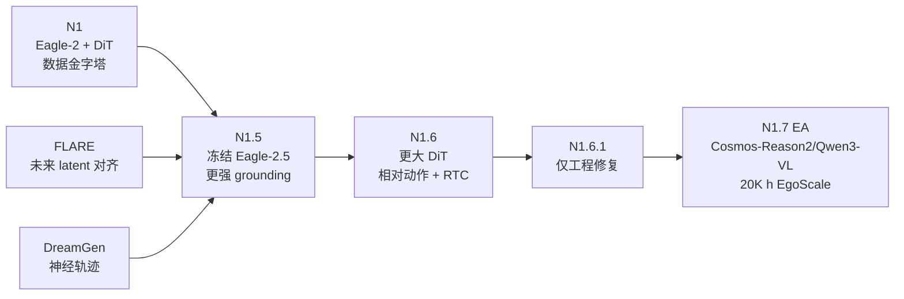

# GR00T 系列综述：从通用人形 VLA 到隐式世界建模

> [!summary] 一句话结论
> GR00T 的主线不是不断叠加“更强的显式世界模型”，而是围绕同一个 **VLM + flow-matching DiT** 骨架，依次改善数据金字塔、视觉语言 grounding、未来表征监督、跨本体数据、相对动作与部署栈；其中 [[Papers/2505-FLARE|FLARE]] 是 N1.5 的关键训练期辅助目标，但它不在测试时生成未来，也不等同于需要 rollout 的完整 [[World Action Model|WAM]]。

## 阅读范围与证据等级

本笔记覆盖截至 2026-09-30 的公开主版本：**GR00T N1、N1.5、N1.6、N1.6.1、N1.7 Early Access**，以及被 N1.5 明确采用的 **FLARE**。DreamGen、DexMG、EgoScale、RTC 等作为数据或部署组件说明，不把它们误列为 GR00T 主模型版本。

| 对象 | 主要资料 | 资料性质 | 可验证程度 |
|---|---|---|---|
| GR00T N1 | [arXiv:2503.14734](https://arxiv.org/abs/2503.14734) | 完整论文 / white paper | 架构、数据、训练和实验较完整 |
| FLARE | [[Papers/2505-FLARE|FLARE 论文笔记]]；[项目页](https://research.nvidia.com/labs/gear/flare/) | 完整论文 + 项目页 | 方法、消融和真机实验较完整 |
| GR00T N1.5 | [[Papers/2503-GR00TN1.5|GR00T N1.5 技术报告笔记]]；[release tag](https://github.com/NVIDIA/Isaac-GR00T/tree/n1.5-release) | 技术报告 + 代码/模型 | 有较完整版本对比，但不是同行评审论文 |
| GR00T N1.6 / 1.6.1 | [[Papers/2503-GR00TN1.6|GR00T N1.6 技术报告笔记]]；[1.6 release](https://github.com/NVIDIA/Isaac-GR00T/releases/tag/n1.6-release) | 技术报告 + 代码/模型 | 有公开 benchmark recipe；跨版本对照不足 |
| GR00T N1.7 | [[ResearchSources/Sources/Isaac GR00T N1.7 Early Access Release|Early Access 说明]]；[模型卡](https://huggingface.co/nvidia/GR00T-N1.7-3B) | EA 代码/模型发布 | 完整 benchmark 尚未发布，结论应保守 |

> [!warning] 日期口径
> 技术页的展示日期与 GitHub 实际发布日不同：N1.5 技术页标注 2025-06-11，而 `n1.5-release` 发布于 2025-12-15；N1.6 技术页标注 2025-12-15，而 `n1.6-release` 发布于 2026-04-15。下文同时保留“技术发布”和“代码 release”两种日期。

## 系列演化

| 版本 | 技术页 / 论文 | 代码发布 | 最主要变化 |
|---|---:|---:|---|
| N1 | 2025-03-27（v2） | 2025-06-11 | 建立跨本体 VLM + DiT flow-matching 基座与数据金字塔 |
| FLARE | 2025-05-21 | 项目页 2025-05-22 | 用未来 latent 对齐代替像素级未来生成 |
| N1.5 | 2025-06-11 | 2025-12-15 | 冻结更强 VLM、加入 FLARE、扩大合成与机器人数据 |
| N1.6 | 2025-12-15 | 2026-04-15 | 更大 DiT、部分解冻 VLM、相对动作、多本体数据与部署工程 |
| N1.6.1 | — | 2026-04-23 | 删除悬空依赖等 minor fixes，无模型方法变化 |
| N1.7 EA | — | 2026-04-18 | Cosmos-Reason2/Qwen3-VL、20K 小时 EgoScale、完整 TensorRT 导出 |

## GR00T N1：系列基座

### 要解决的问题

N1 试图让一个 [[VLA]] 同时服务单臂、双臂和人形机器人，并在少量下游示范下快速适配。它把数据组织成“金字塔”：底部是便宜但动作标签弱的人类视频，中部是仿真和视频生成得到的 synthetic / neural trajectories，顶部是真实机器人轨迹。

### 模型架构

N1 是双系统但端到端耦合的架构：

- **System 2**：Eagle-2 VLM 编码多视角图像与语言指令；公开 2.2B 模型中 VLM 约 1.34B 参数。
- **System 1**：[[DiT|Diffusion Transformer]] 读取本体状态和带噪动作，通过 cross-attention 使用 VLM token，输出连续动作 chunk。
- **跨本体接口**：每种 embodiment 有独立的状态编码器、动作编码器和动作解码器，主体 DiT 共享。
- **控制形式**：动作 horizon $H=16$，L40 bf16 生成一个 chunk 的报告时延为 63.9 ms。

#### Figure 3：N1 架构

视觉语言 token 只作为条件；真正被迭代去噪的是动作 token。这一点使 N1 更接近“VLM 条件化的连续控制器”，而不是在像素空间展开未来的 WAM。

### 训练目标与数据

给定动作块 $A_t$、噪声 $\epsilon$ 和 flow 时间 $\tau$，先构造：

$$
A_t^{\tau}=\tau A_t+(1-\tau)\epsilon.
$$

然后用 [[Flow Matching|flow matching]] 学习速度场：

$$
\mathcal{L}_{\mathrm{fm}}(\theta)
=\mathbb{E}_{\tau}
\left[
\left\|V_{\theta}(\phi_t,A_t^{\tau},q_t)-(\epsilon-A_t)\right\|_2^2
\right].
$$

- $\phi_t$：VLM 对当前图像和语言的表示；
- $q_t$：机器人本体状态；
- $V_\theta$：DiT 预测的动作速度场。

N1 对有动作的机器人数据直接监督，对人类视频先提取 latent action；对 neural trajectories 则使用 latent action 或逆动力学模型生成伪动作。完整预训练统计约 **592.9M frames / 8,375.7 h**，包括 3,288.8 h 机器人数据、2,517.0 h 人类数据、1,742.6 h 仿真和 827.3 h neural data。公开模型预训练 200K steps、global batch 16,384，约消耗 50K H100 GPU-hours。

### 主要结果

在每任务 100 条示范的统一仿真评估中：

| 方法 | RoboCasa | DexMG | GR-1 | 平均 |
|---|---:|---:|---:|---:|
| BC Transformer | 26.3 | 53.9 | 16.1 | 26.4 |
| Diffusion Policy | 25.6 | 56.1 | 32.7 | 33.4 |
| **GR00T N1-2B** | **32.1** | **66.5** | **50.0** | **45.0** |

真实 GR-1 的四组任务中，N1 全量数据平均成功率 **76.8%**，Diffusion Policy 为 **46.4%**；N1 只用 10% 数据仍有 **42.6%**。但论文也显示，任务专门化 post-training 可能遗忘预训练时出现的跨手协作行为。

### N1 的边界

- 主要仍是短程桌面操作；长程 loco-manipulation 尚未解决。
- 人类视频依赖 latent action / IDM 伪标签，标签质量会成为瓶颈。
- synthetic video 的物理一致性和反事实多样性有限。
- “System 1 / System 2”是工程分工，不表示存在显式规划器或可查询的世界状态。

## FLARE：N1.5 的隐式世界建模目标

### 核心思想

[[Future Latent Representation Alignment|FLARE]] 不要求策略重建未来每个像素，而是在 action DiT 中加入 $M$ 个可学习 future tokens，让其中间层预测 $t+H$ 时刻的紧凑视觉语言表示。这样未来预测成为动作学习的辅助监督，而不是测试时必须执行的视频生成步骤。

#### Figure 2：FLARE 架构

DiT 输入由状态 token、带噪动作 token 和 future tokens 拼接而成；三者通过 self-attention 交互，当前视觉语言表示通过 cross-attention 注入。论文在 8 层 DiT 的第 6 层读取 future-token hidden states。

### 未来表征对齐

FLARE 的未来对齐损失为：

$$
\mathcal{L}_{\mathrm{align}}(\theta)
=-\mathbb{E}_{\tau}
\left[
\cos\!\left(
f_{\theta}(\phi_t,A_t^{\tau},q_t),
g(\phi_{t+H})
\right)
\right].
$$

- $f_\theta\in\mathbb{R}^{B\times M\times D}$：DiT 中间层的 future-token 预测；
- $g\in\mathbb{R}^{B\times M\times D}$：目标未来观测的 teacher encoder；
- $M=32$：论文默认未来 token 数。

总目标为：

$$
\mathcal{L}=\mathcal{L}_{\mathrm{fm}}+\lambda\mathcal{L}_{\mathrm{align}},
\qquad \lambda=0.2.
$$

部署时不需要计算 $g(\phi_{t+H})$，也不需要生成未来图像；额外代价主要是少量 future tokens 的注意力计算。

### Action-aware teacher

直接用通用 SigLIP2 表征也有效，但论文额外预训练了一个控制导向的 teacher：

1. SigLIP2 分别编码 $256\times256$ 图像和语言；
2. 4 层 self-attention 融合视觉与语言 token；
3. Q-Former 用 32 个 query token 压缩多相机输入；
4. 接 8 层 DiT 做动作 flow matching，让表示显式保留控制相关信息。

teacher 使用约 169.5M frames / 2,989.5 h 的跨本体机器人与仿真数据预训练。下游训练时，目标 encoder 不完全冻结，而以 $\rho=0.995$ 的 EMA 跟随 policy encoder：

$$
\theta_{\mathrm{target}}
\leftarrow
\rho\theta_{\mathrm{target}}
+(1-\rho)\theta_{\mathrm{policy}}.
$$

### 实验结论

| 方法 | RoboCasa 24 任务 | GR-1 仿真 24 任务 |
|---|---:|---:|
| **FLARE** | **70.1** | **55.0** |
| Policy only | 61.9 | 44.0 |
| UWM（像素/VAE latent 预测） | 60.8 | 29.5 |
| GR00T N1 from scratch | 60.6 | 45.1 |
| Diffusion Policy | 51.7 | 40.9 |

关键消融：

- 通用 SigLIP2 teacher 为 49.6%，平均池化后为 50.9%，action-aware teacher 为 **55.0%**，无 FLARE 为 43.9%。收益不只来自“多一个 loss”，目标表示的控制相关性很重要。
- 真实 GR-1 四任务、每任务 100 条轨迹时最高平均成功率 **95.1%**，比 policy-only 平均高约 14 个百分点。
- 对 5 个新物体，每个物体只有 1 条机器人轨迹时，加入 150 条人类第一视角视频可把成功率从 37.5% 提至 **60.0%**；10 条机器人轨迹时从 42.5% 提至 **80.0%**。

#### Figure 7：无动作人类视频与少样本机器人示范

无动作的人类视频只计算 $\mathcal{L}_{\mathrm{align}}$；有动作的机器人轨迹同时计算 flow matching 与未来对齐。这是 FLARE 比 N1 的 latent-action / IDM 伪标注更简洁的地方。

### FLARE 到底是不是 WAM？

| 维度 | 像素生成式 WAM | FLARE | 直接 VLA |
|---|---|---|---|
| 训练目标 | 未来帧/视频 + 动作 | 未来 latent 对齐 + 动作 | 仅动作 |
| 测试时未来 rollout | 常见 | **没有** | 没有 |
| 可视化未来 | 可以 | 不可以 | 不可以 |
| 用未来预测做显式规划 | 可以设计 | 论文没有 | 没有 |
| 无动作视频监督 | 可以 | **可以，只算对齐 loss** | 通常不可以 |
| 主要成本 | 视频生成模型与迭代采样 | teacher 预训练；训练期 target 编码 | 动作模型本身 |

我的判断是：FLARE 可以称为**隐式 latent world-modeling objective**，但按较严格的 [[World Action Model]] 定义，它还不是一个完整的 WAM：没有可供控制器查询或 rollout 的显式转移模型，也没有在推理时比较多个未来。它更像“带动作条件的未来表征预测正则器”。其价值恰恰在于证明：**world-model supervision 可以有用，而 test-time imagination 未必必要。**

## GR00T N1.5：冻结语义、加入 FLARE

### 相对 N1 的改变

- **VLM**：升级为 Eagle 2.5，并针对 grounding 与 physical understanding 调整。
- **优化策略**：VLM 在预训练和 post-training 都冻结，避免动作训练破坏语言和视觉语义。
- **接口**：简化视觉 adapter，并在送入 LLM 的视觉/文本 token 上加入 LayerNorm；公开模型仍保留 4 层 post-VLM transformer adapter。
- **训练目标**：flow matching 外加入 FLARE，预训练和 post-training 的系数均为 0.2。
- **数据**：在 N1 mixture 上加入 DreamGen neural trajectories、AgiBot-Beta 等。

#### N1.5 架构图

训练规模为 **250K steps、1K H100、global batch 16,384**，AdamW + cosine schedule，warmup ratio 0.05。

### 关键结果

| 评测 | N1 | N1.5 |
|---|---:|---:|
| Language Table（scratch） | 52.8% | **93.2%** |
| Sim GR-1 Language（scratch） | 36.4% | **54.4%** |
| RoboCasa，30 demos/task | 17.4 | **47.5** |
| 真机语言遵循 | 46.6% | **93.3%** |
| 真机总体成功率 | 43.3% | **83.0%** |
| Unitree G1，已见物体 | 44.0% | **98.8%** |
| Unitree G1，新物体 | — | **84.2%** |

另外，N1.5 对 10 个预训练未见物体有 15% zero-shot 成功率；用包含这些物体的人类视频做 FLARE post-training 后为 55%。DreamGen 增加的 12 个动词任务为 38.3%，N1 为 13.1%，但这些任务已经通过合成轨迹进入训练，不能称为严格 zero-shot。

### 公开代码与技术报告的边界

`n1.5-release` 的 action head 仍创建 32 个 future tokens，但训练代码明确写着 `not using flare now`，实际只返回 action MSE loss。较稳妥的解释是：**N1.5 基座预训练使用了 FLARE，公开微调路径没有开放 FLARE teacher 与对齐 loss**。因此仅用公开 fine-tuning 脚本不能复现技术页中的完整 N1.5 训练 recipe。

## GR00T N1.6：容量、相对动作与部署工程

### 架构与数据变化

- VLM 支持原始宽高比和 flexible resolution；技术页称其为内部 NVIDIA Cosmos-2B 变体，公开仓库则通过 `EagleBackbone` 与 `Eagle-Block2A-2B-v2` 暴露，命名并不完全一致。
- DiT 从 N1.5 的 16 层扩大到 **32 层**。
- 移除 N1.5 的 4 层 post-VLM adapter，预训练时改为解冻 VLM 顶部 4 层。
- 大多数 embodiment 改预测 **state-relative action chunks**，提升平滑度和精度。
- 新增数千小时 Bimanual YAM、AgiBot Genie-1、BEHAVIOR 中的 Galaxea R1 Pro，以及 Unitree G1 whole-body loco-manipulation 数据。

N1.6 预训练 300K steps、global batch 16,384；任务 post-training 常用 10K–30K steps，global batch 不超过 1K。

### 训练和部署经验

- 相对动作更平滑，但小数据下会积累误差、削弱闭环纠错。
- 预训练归一化统计只适合与预训练分布相近的任务；分布不同应使用 post-training 统计。
- N1.6 收敛快但更容易过拟合，需要更强 state regularization、数据增强和 pretraining-data co-training。
- DAgger 能有效补救真机分布偏移。
- train-time / test-time [[Real-time Action Chunking|RTC]] 与 async rollout 可改善动作连续性和鲁棒性。

### 公开 benchmark

| 公开 recipe / checkpoint | 结果 |
|---|---:|
| LIBERO Spatial | 97.65% |
| LIBERO Goal | 97.5% |
| LIBERO Object | 98.45% |
| LIBERO 10 Long | 94.35% |
| SimplerEnv Bridge | 62.07% |
| SimplerEnv Fractal | 67.66% |
| RoboCasa Panda/Omron（base checkpoint） | 66.22% |
| GR-1 Tabletop 24 tasks（base checkpoint） | 47.6% |

这些数字来自 release tag 内的 benchmark README；其中有 base checkpoint，也有下游 fine-tuned checkpoint，协议与 N1/N1.5 技术页不统一，**不能据此直接宣称 N1.6 比 N1.5 提升多少**。

### N1.6.1

N1.6.1 只删除 Dockerfile 和 `pyproject.toml` 中的悬空引用，属于工程修复，不是新模型或新训练版本。

## GR00T N1.7 Early Access：换 backbone、加人类视频、补部署链

### 公开变化

- VLM 换成 **Cosmos-Reason2-2B（Qwen3-VL 架构）**，支持 flexible resolution 与原始宽高比。
- 预训练加入 **20K 小时 EgoScale 人类视频**；官方只给出“与 N1.6 性能相当、泛化和语言遵循更好”的定性陈述。
- 公共配置把 action horizon 设为 40、DiT 设为 16 层；这说明 N1.7 并不是简单沿用 N1.6 的 32 层动作头。
- 简化数据处理管线，增加完整 pipeline 的 ONNX / TensorRT 导出。
- 模型 3B；EA 模型卡报告 H100 上 4-step、单相机 TensorRT 端到端 27.9 ms（35.9 Hz），PyTorch eager 为 85.8 ms。

### 为什么暂时不能下强结论

N1.7 明确标为 Early Access，GA 才承诺完整 benchmark 和稳定功能集。现有发布材料没有给出可与 N1.6 对齐的正式主结果表；仓库里的 LIBERO 表与 N1.6 tag 数值相同，也不足以证明版本特定收益。因此当前最可靠的结论只是：

1. backbone、数据和部署栈已变化；
2. 20K 小时人类视频是 N1.7 泛化主张的核心依据；
3. “泛化更好”尚缺完整公开消融和统一协议支持。

另外，GitHub README 把 N1.7 描述为 Apache 2.0 可商用，而 Hugging Face 权重页列的是 NVIDIA Open Model License；实际使用时应分别核对代码和权重许可证，不要只看一句宣传说明。

## 跨版本技术对比

| 版本 | VLM / 更新方式 | 动作模型 | 世界模型信号 | 数据侧重点 | 公开复现状态 |
|---|---|---|---|---|---|
| N1 | Eagle-2；冻结语言组件、更新其余部分 | DiT flow matching，$H=16$ | 人类/生成视频先转 latent/IDM action | 数据金字塔，8,375.7 h | 论文、代码、权重齐全 |
| N1.5 | Eagle-2.5；VLM 全冻结 | 16-layer DiT + 4-layer adapter | **FLARE，$\lambda=0.2$** | DreamGen、AgiBot-Beta、人类视频 | 基座开放；FLARE 训练路径未完整开放 |
| N1.6 | 技术页称内部 Cosmos-2B；代码为 EagleBackbone；解冻顶 4 层 | **32-layer DiT**；多数本体用 relative action | 技术页未明确；公开 forward 仅 action loss | 多本体遥操作与 loco-manipulation | benchmark recipe 较丰富 |
| N1.7 EA | Cosmos-Reason2-2B / Qwen3-VL | 公共配置 16-layer DiT，$H=40$ | 公开 forward 仅 action loss | 20K h EgoScale 人类视频 | 权重和代码可用，完整评测待 GA |

> [!important] FLARE 是否延续到 N1.6/N1.7？
> 目前没有足够公开证据。N1.5 技术报告明确写了 FLARE；N1.6/N1.7 的公开训练前向路径只计算动作 flow-matching loss，没有 future-token alignment。后续版本可能在内部预训练使用过未开放的目标，但不能据现有代码把它当成已确认事实。

## 与 π 系列和 WAM 的关系

### 与 π 系列

- 两者都以预训练 VLM 提供语义条件，以连续 flow matching 生成 [[Action Chunking|动作 chunk]]。
- π0 的 action expert 与 VLM 共享 attention、保留独立 FFN；N1 使用独立 cross-attention DiT，并用 embodiment-specific I/O adapter 统一动作空间。
- N1.5 的“冻结 VLM”与 [[KI|Knowledge Insulation]] 都在保护视觉语言知识，但策略不同：N1.5 完全冻结，KI 仍允许离散动作/语言信号训练 VLM，只阻断连续动作梯度。
- FLARE 把未来观测表示注入动作模型；FAST/KI 则主要解决动作 tokenization 与知识污染，不直接监督未来状态。

### 与 WAM

GR00T N1 本身是直接动作 VLA；N1.5 + FLARE 才显式加入未来表示监督。即使如此，它仍不在测试时“先想象视频再行动”。所以 GR00T 更准确的定位是：

> **具有隐式世界模型辅助训练的 flow-matching VLA，而不是以 test-time video rollout 为核心的 WAM。**

这和 [[Fast-WAM]] 的结论形成呼应：未来建模最大的价值可能是训练期的表征塑形，不一定来自推理期逐帧生成。

## 对具身智能研究最有用的启发

1. **把 future prediction 当监督，而不是强制的推理模块。** 先比较 policy-only、latent alignment 和 test-time imagination，避免把视频生成成本默认带到部署端。
2. **teacher 表示比 loss 形式更关键。** FLARE 的 action-aware embedding 明显强于通用 SigLIP2；要研究的是“未来表示保留了哪些控制充分统计量”。
3. **无动作视频最好通过共享目标空间进入。** FLARE 不需要为人类视频伪造精确机器人动作，只要求它提供未来表征目标，能缓解 embodiment gap，但仍依赖视角和任务分布相近。
4. **相对动作与异步执行是模型外的重要增益。** N1.6 的经验说明，高 benchmark 分数不自动转化为平滑真机控制，动作参数化、归一化、RTC 和 DAgger 同样关键。
5. **版本比较必须统一协议。** N1/N1.5 的技术页、N1.6 的 repo benchmark 和 N1.7 EA 模型卡混用了 zero-shot、few-shot、fine-tuned 和不同机器人，不能拼成一条虚假的单调上升曲线。

### 值得直接验证的实验

- 在现有 π / OpenPI action expert 中加入 32 个 future tokens，只在训练期做 latent alignment，对比通用视觉 teacher 与 action-aware teacher。
- 固定数据和控制频率，比较 absolute action、relative action 与 RTC，单独量化误差积累和纠错能力。
- 对同一 WAM 基座做三组：训练期视频/latent 辅助、测试期无 imagination、测试期显式 imagination；测成功率、延迟和 OOD 泛化。
- 对无动作第一视角视频，比较 latent alignment、latent action 伪标签和 IDM 伪标签，重点看跨本体的新物体抓取。

## 批判性总结

### 优点

- 系列演化高度工程化：每版都围绕真实部署瓶颈修改 backbone、监督、数据和控制接口。
- FLARE 给出了一条比像素生成便宜得多的世界建模路径，并用 action-aware teacher 和人类视频实验支撑。
- N1.6 以后公开了更完整的 benchmark recipe、server-client 推理和硬件部署信息。

### 局限

- N1.5 之后缺少同等完整、同行评议式的技术论文；许多结论来自第一方技术页。
- 各版本评测协议不统一，跨版本数字很难严格比较。
- 公共代码与技术页不总是一致，特别是 FLARE、N1.6 backbone 命名和 N1.7 许可证说明。
- FLARE 主要验证桌面 pick-and-place，尚未证明它能支持长时规划、反事实 rollout 或复杂接触推理。

### 个人笔记

> [!note] 我的记录
> - 与当前研究的联系：
> - 值得复现或验证：
> - 尚未理解的问题：
> - 其他：

## 资料入口

- [GR00T N1 paper](https://arxiv.org/abs/2503.14734)
- [FLARE paper](https://arxiv.org/abs/2505.15659)
- [GR00T N1.5 technical report](https://research.nvidia.com/labs/gear/gr00t-n1_5/)
- [GR00T N1.6 technical report](https://research.nvidia.com/labs/gear/gr00t-n1_6/)
- [Isaac-GR00T release history](https://github.com/NVIDIA/Isaac-GR00T/releases)
- [GR00T N1.7 model card](https://huggingface.co/nvidia/GR00T-N1.7-3B)
